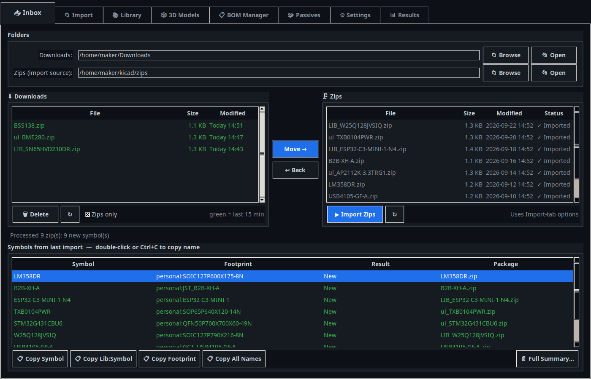
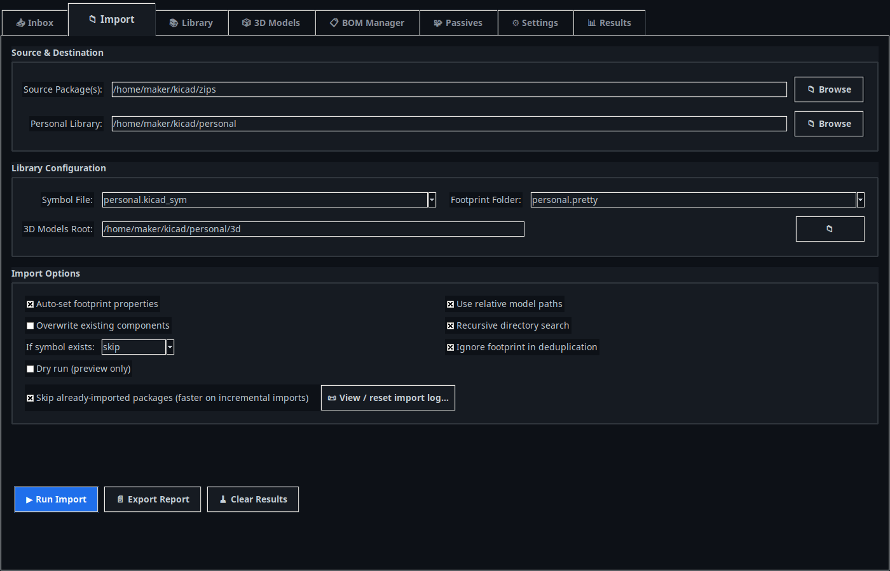
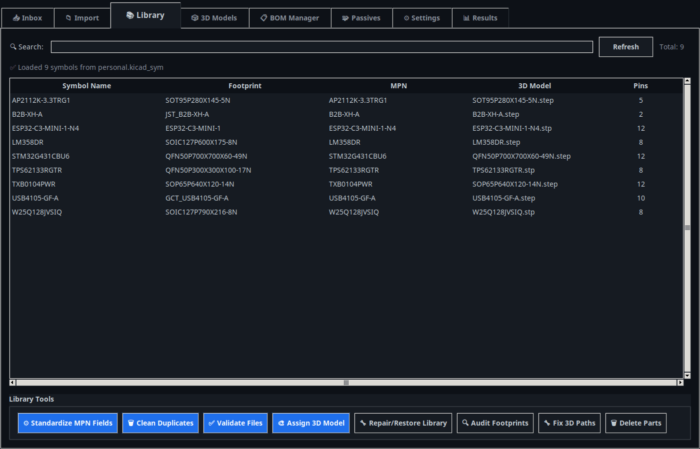
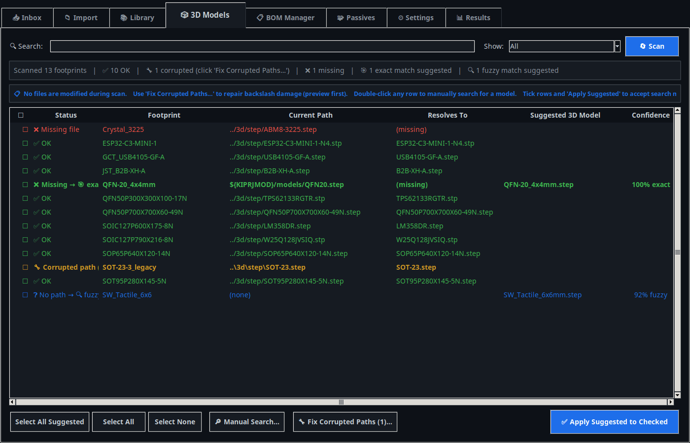
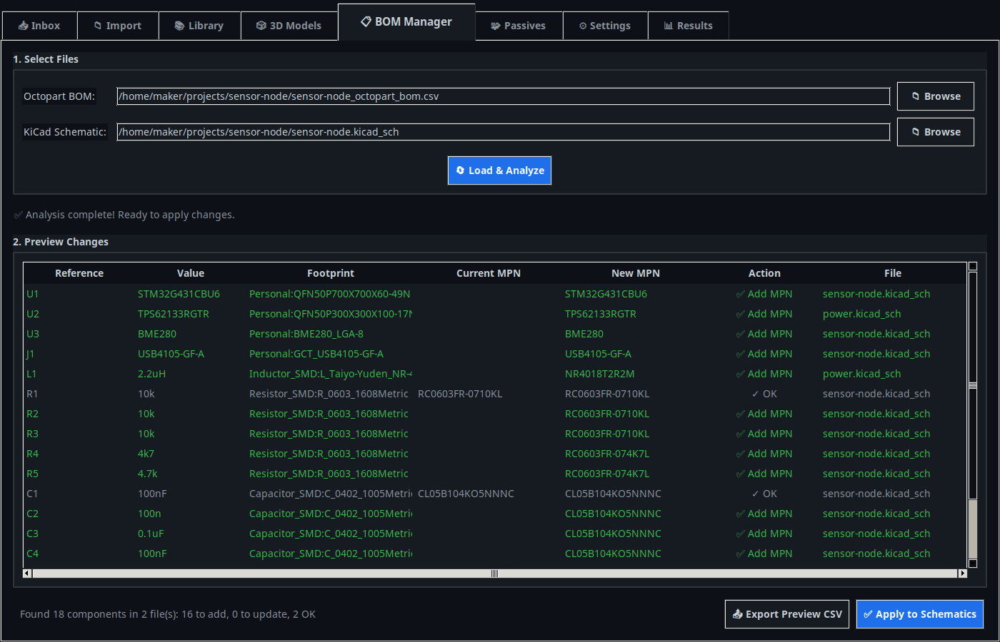
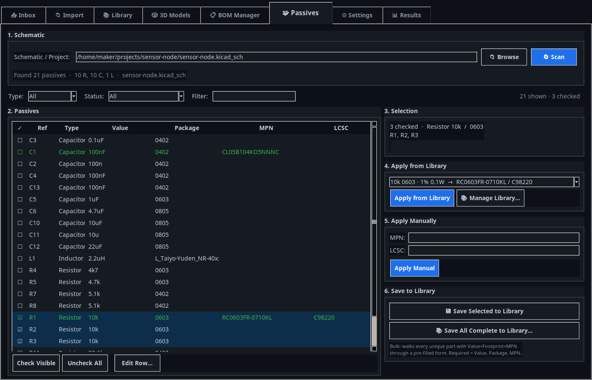
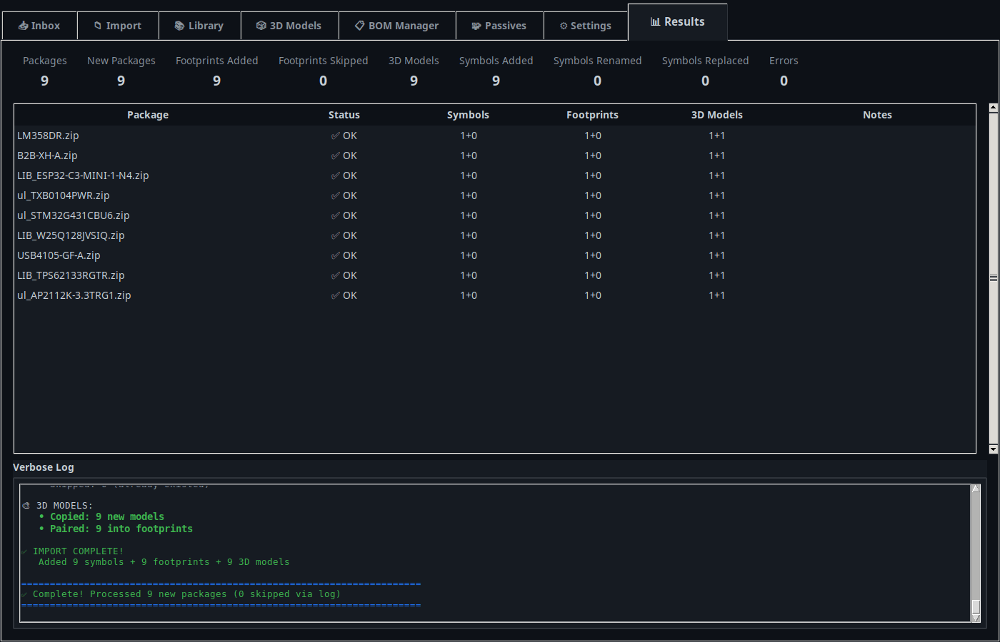

# KiCad PartBench

A desktop workbench for keeping a **personal KiCad 9/10 library** in order.

Download a part from UltraLibrarian, SnapEDA or SamacSys, drop the ZIP in a folder, and PartBench merges the symbol, footprint and 3D model into one library. It removes duplicate symbols, pairs each footprint with its STEP model, and writes relative paths so the library works on any machine. It can also fill in MPN/LCSC fields across a whole schematic, from an Octopart BOM or from your own list of preferred passives.

**One Python file · tkinter · no dependencies · Windows, macOS, Linux**



---

## Contents

- [Quick start](#quick-start)
- [Library layout](#library-layout)
- [Tabs](#tabs)
  - [Inbox](#-inbox): move downloads into the import folder and import in one click
  - [Import](#-import): import options and full runs
  - [Library](#-library): browse, validate and repair the library
  - [3D Models](#-3d-models): find and fix broken model paths
  - [BOM Manager](#-bom-manager): push an Octopart BOM's MPNs into your schematics
  - [Passives](#-passives): assign MPN/LCSC to resistors, capacitors and inductors in bulk
  - [Settings and Results](#%EF%B8%8F-settings-and--results)
- [Standalone repair tools](#standalone-repair-tools)
- [Files PartBench writes](#files-partbench-writes)
- [Development](#development)

---

## Quick start

Requirements: **Python 3.10 or newer** with tkinter. The python.org installers for Windows and macOS include tkinter. On Linux, install it with `sudo apt install python3-tk` or your distro's equivalent.

```bash
git clone https://github.com/cottonnj/kicad-partbench.git
cd kicad-partbench
python kicad_partbench.py
```

On first run:

1. On the **Import** tab, set **Personal Library** to the folder that holds (or will hold) your library.
2. Pick a **Symbol File** (`*.kicad_sym`) and **Footprint Folder** (`*.pretty`). PartBench lists any it finds in that folder, or you can type a new name.
3. Set **Source Package(s)** to the folder where you keep vendor ZIPs.
4. In KiCad, add the symbol file and footprint folder to your symbol and footprint library tables once. On Windows, the **Settings** tab can set `${PERSONAL_LIB_DIR}` and rewrite `fp-lib-table` for you.

Your settings are saved between runs.

## Library layout

PartBench works with an ordinary KiCad library folder:

```
personal/
├── personal.kicad_sym        # all symbols (any name)
├── personal.pretty/          # all footprints (any name)
│   └── SOIC127P600X175-8N.kicad_mod
└── 3d/
    └── step/
        └── LM358DR.step
```

Footprints point to their models with relative paths such as `../3d/step/LM358DR.step`, so you can move the folder, sync it, or commit it to git and the paths still work. You can switch to absolute paths on the Import tab.

---

## Tabs

### 📥 Inbox


The Inbox shows your browser's **Downloads** folder on the left and your **zips** folder (the import source) on the right.

- New downloads show in green (anything from the last 15 minutes). Zips that were already imported show **✓ Imported**.
- **Move →** (or double-click) moves the selected downloads into the zips folder. **↩ Back** moves a zip back to Downloads. **🗑 Delete** sends a wrong download to the Recycle Bin or Trash.
- **Import Zips** runs an import with the Import tab's settings and stays on this tab. The table below lists every symbol from that import with its footprint.
- Double-click or press **Ctrl+C** to copy a symbol name. The buttons copy `Lib:Symbol`, the footprint, or every name at once, ready to paste into KiCad's symbol chooser.

Both lists refresh every 2 seconds while the tab is open.

### 📁 Import



Imports every vendor package in the source folder: ZIPs, extracted folders, or a mix of both, searched recursively.

- **Symbols** are parsed and merged into your symbol file. Before each write the file is sanitized: a single root, two-space indentation, `(hide yes)`, units named in KiCad's `Parent_u_c` style, and a `.bak` backup.
- **Duplicates** are found by comparing symbol content, not names, so the same part downloaded twice under different names isn't added twice. The deduplication mode (Settings) can compare exact content, ignore vendor property noise (the default), or compare pins only.
- **Footprints** are copied into your `.pretty` folder. With **Auto-set footprint properties** on, each symbol's `Footprint` field is set to `YourLib:FootprintName`.
- **3D models** are paired with footprints: first one-to-one, then by file-name stem, then by fuzzy match, then by the symbol's MPN or Value. The model path is written into the footprint.
- **Skip already-imported packages** records each ZIP (by path, size and modification time) in an import log, so adding one part to a folder of 50 processes only that one part.
- **Dry run** shows what would change without writing anything.

### 📚 Library



Lists every symbol with its footprint, MPN, 3D model and pin count. The search box filters the list. The tools along the bottom:

| Tool | What it does |
|---|---|
| **Standardize MPN Fields** | Copies `Manufacturer_Part_Number`, `Mfr Part Number`, `P/N` and similar fields into one `MPN` property |
| **Clean Duplicates** | Groups `_imp1`, `_1_1`-style copies and keeps the original |
| **Validate Files** | Checks the symbol file and footprints for problems that stop KiCad from loading them |
| **Assign 3D Model** | Assigns a model to footprints by hand when automatic pairing fails |
| **Repair/Restore Library** | Rebuilds the symbol file, or restores it from the `.bak` backup |
| **Audit Footprints / Fix 3D Paths** | Finds missing `(model …)` blocks and rewrites them |
| **Delete Parts** | Removes the selected symbols from the symbol file (a `.bak` copy is kept first). Footprints and models stay |

### 🎲 3D Models

> ⚠️ **Experimental.** This tab has known bugs and is incomplete. Check its results and back up your files before applying changes. See [#1](https://github.com/cottonnj/kicad-partbench/issues/1).



Scans every footprint and checks each 3D model path. Scanning never changes any files.

- **Missing file** / **No path**: PartBench searches the library for a matching model and suggests it with a confidence score (exact or fuzzy). Tick the rows and click **Apply Suggested to Checked**.
- **Corrupted path**: Windows backslashes in a model path (`..\3d\step\x.step`) break KiCad, which reads `\3` as an escape character. **Fix Corrupted Paths…** shows each current and proposed path so you can untick any row before fixing.
- Double-click a row to search for a model by hand.

### 📋 BOM Manager

> ⚠️ **Experimental.** This tab has known bugs and is incomplete. Check its results and back up your files before applying changes. See [#1](https://github.com/cottonnj/kicad-partbench/issues/1).



Pushes the MPNs from an **Octopart BOM** (`.xlsx` or `.csv`) back into your KiCad schematics, including hierarchical sub-sheets.

1. Choose the BOM and the top-level `.kicad_sch` (or `.kicad_pro`).
2. **Load & Analyze** matches BOM rows to schematic references. Grouped designators such as `R1, R2, R3` are expanded. Each match is marked **Add MPN**, **Update** or **OK**.
3. Check the preview (**Export Preview CSV** saves it), then click **Apply to Schematics**.

The BOM needs a reference column (`Designator`, `Reference` or `Ref`) and an MPN column (`Matched Part Number`, `MPN` or `Part Number`). `Value`, `Footprint`, `Manufacturer`, `Datasheet` and `Description` columns are used if present.

### 🧩 Passives

> ⚠️ **Experimental.** This tab has known bugs and is incomplete. Check its results and back up your files before applying changes. See [#1](https://github.com/cottonnj/kicad-partbench/issues/1).



Assigns MPN, LCSC and spec fields to resistors, capacitors and inductors from your own list of preferred parts, without editing each component by hand.

- **Scan** a schematic or project. Every R, C and L is listed, including those on sub-sheets. Values are normalized, so `4k7` = `4.7k` and `µF` = `uF`, while `m` (milli) and `M` (mega) stay distinct.
- Tick rows and apply a part from your library (**Apply from Library**) or type values in (**Apply Manually**). The chosen fields (MPN, LCSC, Tolerance, Voltage, Dielectric, Power, Isat, …) are written to every ticked instance. A confirmation lists any existing value that would be overwritten.
- The library is a single JSON file in your home folder (`~/.kicad-library-tool/passives.json`) that every project shares. Manage it with **Manage Library…** (add, edit, import, export). **Save All Complete to Library…** steps through each part that is already filled in so you can save it for reuse.
- Filter the list by type, by status (Missing MPN, Missing LCSC, …) or by text.

### ⚙️ Settings and 📊 Results

**Settings** holds the footprint library nickname (it can be detected from `fp-lib-table` and `sym-lib-table`), the deduplication mode, and the preferred package type (ZIP or extracted folder). On **Windows**, it also sets the `${PERSONAL_LIB_DIR}` path variable in KiCad and rewrites `fp-lib-table` to use it.

**Results** shows counts per package for the last import (symbols, footprints and models added, skipped or renamed) and a verbose log. **File → Export Report…** saves it.



---

## Standalone repair tools

[`tools/`](tools/) has three small single-purpose repair tools, each with its own window. They're useful for fixing a library that was damaged before you started using PartBench. See [tools/README.md](tools/README.md).

| Script | Fixes |
|---|---|
| `symbol_deduplicator.py` | Duplicate symbols with `_imp1`, `_imp2`, `_1_1` suffixes |
| `fix_broken_footprints.py` | Literal `\n` text in footprint files, which stops KiCad from reading them |
| `repair_broken_symbols.py` | `MPN` properties inserted inside another property, which breaks the S-expression |

## Files PartBench writes

| File | Purpose |
|---|---|
| `~/.kicad_personal_importer.json` | Saved settings (folders, options) |
| `~/.kicad-library-tool/passives.json` | Passives library |
| `<library>/.kicad_personal_import_log.json` | Import skip-list. Clear it from **Tools → View / Reset Import Log…** |
| `*.bak` next to edited files | Backup made before every write to a symbol file |

Close KiCad's symbol and footprint editors before applying changes, and keep your library under version control (or at least backed up). PartBench makes `.bak` copies, but it does rewrite your files.

## Development

Everything is in `kicad_partbench.py`. The tests use only the standard library:

```bash
python -m unittest discover -s tests -v     # add `xvfb-run -a` in front on a headless Linux box
ruff check .                                # bug-class rules only; see ruff.toml
```

- `tests/test_core.py`: the parsing and normalization helpers, with no GUI.
- `tests/test_features_*.py`: feature tests that start the real app against a throwaway **practice library** and click through each tab's buttons, then check what was written to disk. [`tests/practice_lib.py`](tests/practice_lib.py) builds that library (vendor ZIPs in three layouts, duplicate symbols, broken 3D paths, a hierarchical project, Octopart BOMs). [`tests/gui_harness.py`](tests/gui_harness.py) drives the app and records dialogs instead of showing them. The feature tests are skipped when no display is available.
- Known bugs are tests marked `@unittest.expectedFailure` with a `# BUG:` comment. When you fix one, the test starts passing unexpectedly; remove its decorator.

To poke at the practice library by hand: `python tests/practice_lib.py /tmp/practice`.

CI runs everything on Python 3.10–3.13 on Ubuntu and Windows. [CHANGELOG.md](CHANGELOG.md) has the version history.

## License

[MIT](LICENSE)
